# Microserviço de Administração do Catálogo de Vídeo do Sistema Codeflix

### sumario
- [apresentacao do projeto](#apresentacao-do-projeto)
Documentação/Design: 
  explique DDD, C4, event storming, hexagonal, princípios de design.
Características do projeto: 
  visão geral, tecnologias, arquitetura.
Etapas de construção: 
  descreva seu processo (modelagem, core, testes, integração etc.).

- [Estilos e padroes arquiteturais](#estilos-e-padroes-arquiteturais)
- [Arquitetura orientada a eventos](#arquitetura-orientada-a-eventos)
- [Mensageria - comunicacao assincrona e processamento assincrono](#mensageria---comunicacao-assincrona-e-processamento-assincrono) 

Implementação técnica: 
  detalhar cada seção do sumário da imagem (nestjs, docker, testes, mensageria, eventos etc.).
Boas práticas: 
  validações, tratamento de erros, observabilidade, CI/CD, configurações de qualidade.
Execução: 
  orientações finais (como rodar o projeto).

---
### apresentacao do projeto
- Aplicação backend administrativa do catálogo de vídeos do sistema Codeflix (inspirado na Netflix).
  - Backend: processa regras de negócio e dados, fornecendo APIs e serviços para outros consumirem, sem interação direta com o usuário final.
  - administrativa: organização e ao gerenciamento de atividades, recursos ou pessoas.
    - Gerenciamento: atividade de organizar e controlar recursos ou tarefas para alcançar um objetivo.
  - Catálogo: conjunto organizado de itens, apresentado para que possam ser conhecidos, consultados ou escolhidos.
- Construído durante o curso Full Cycle 3.

- Principais tecnologias utilizadas: TypeScript, NestJS, MySQL/SQLite, Sequelize(ORM), RabbitMQ(mensageria) e Google Cloud Storage.

---
### documentacao, arquitetura, design

<details>
  <summary>
    <strong>Diagrama C4</strong> (níveis de container e contexto)<br/>
    Utilizado para descrever a arquitetura do sistema em diferentes níveis de detalhe visual.<br>
    <small>Imagem (clique para expandir)</small>
  </summary>
  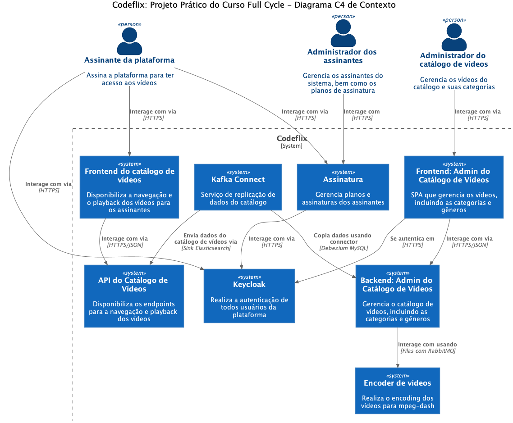
  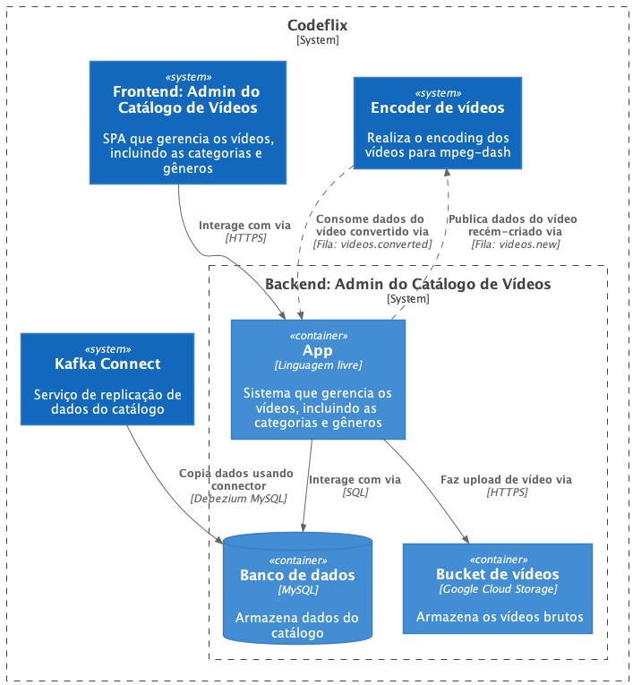
</details>
<br>

**Design Docs**  
  Design docs são documentos que detalham a arquitetura, decisões técnicas, fluxos e estruturas do sistema. Eles servem para alinhar o time de desenvolvimento e são referência durante a implementação e manutenção do projeto.  

### etapas de construção da aplicação backend
- Montagem do ambiente de desenvolvimento (Docker e IDE)
- modelar o core(regras de negocio, ...) antes de ir para o framework nestjs, usando ddd e clean archtecture
- criar uma pasta shared(logica compartilhavel)
- Criar uma aplicação TypeScript (core)
  - Criar entidade de Categoria
  - Criar testes (pirâmide de testes)
    - unitario, integração
  - Criar Casos de Uso e Repositório
  - Nest.js - Criação de API Rest
  - Criar testes e2e (end-to-end)
  - Repetir para as outras entidades, cast member, genre, video
- Integração com RabbitMQ e Encoder de vídeo
- keycloak
- logs
  - rastrear comportamento
- CI
  - esteira no github actions
  - docker file para produção
      - imagem menor, otimizada
      - vai ser usada no cd
---

### DDD
  - entities, aggregates
    - category
      - Categoria: um conjunto de coisas agrupadas porque compartilham uma característica geral em comum.
      - Categoria = onde algo se encaixa pelo tipo geral.
      - Categoria olha para a classe/espécie da coisa.
      - Categoria agrupa pela natureza/tipo.
      - filme, documentário, infantil
    - cast-members
      - "membro do elenco", uma pessoa (ator, atriz, diretor, etc.) que faz parte da produção de um filme, série ou peça.
    - genre
      - Gênero: uma categoria mais específica usada para agrupar coisas que compartilham características de estilo, estrutura ou padrão.
      - Gênero = o estilo/padrão que algo segue dentro de uma categoria.
      - Gênero agrupa pela forma/estilo/padrão.
      - Filme → gênero: terror, comédia, ação, drama
      - Estilo é o modo particular de fazer, expressar ou apresentar algo, caracterizado por traços distintivos que diferenciam um autor, obra, período ou grupo.
    - video
      - video: significa registro ou exibição de imagens em movimento, geralmente acompanhado de som.
  - object value
    - uuid, search-params, search-result, cast-member-type, 
    - rating
        - classificação" é a categoria atribuída ao conteúdo, enquanto "faixa etária" é o intervalo ou limite de idades ao qual essa categoria se aplica.
    - imageMedia
      - banner, thumbnail-half, thumbnail
    - audiovideomedia
      - video principal, trailer
  - repository
    - category
    - cast-member
  - shared kernel
    - src/core/shared
  - eventos de dominio e integracao
    - src/core/video/domain/domain-events/video-audio-media-replaced.event.ts
  - encapsulamento
    - src/core/cast-member/domain
      - As regras de validação e o estado crítico das regras de negócio são mantidos dentro do domínio. Os objetos protegem seus invariantes através de validadores dedicados e classes base (Entity, ValueObject).
        - Regra de negócio: condição ou critério que define como o negócio funciona.
        - Invariante: condição que deve permanecer verdadeira em determinado estado do sistema.
  - Imutabilidade (Imutability):
    - Imutabilidade: um valor não pode ser alterado depois de criado.
      - Como funciona: para representar um novo valor, cria-se outro objeto.
      - Finalidade: evitar que uma alteração em um lugar afete inesperadamente outras partes do sistema.
    - src/core/cast-member/domain/cast-member-type.vo.ts
      - Forte utilização de Value Objects (Uuid, Rating, Banner, AudioVideoMedia, etc.). 
  - Bounded context não é uma pasta. Também não é src/core/category nem “tudo que está em core” como se fosse um módulo isolado.
    - É o limite do modelo e da linguagem. Neste repositório o contexto é um só: administração do catálogo de conteúdo. O microserviço inteiro (API + core + Nest) é esse contexto.
    - O que você vê em src/core são módulos / agregados dentro do mesmo contexto
    - Outro bounded context seria outro serviço, com outro vocabulário. No Codeflix
      - Admin catálogo (este repo)
      - Encoder / processamento de mídia
      - Catálogo de exibição (frontend)
      - Identidade
  - validacao
      - src/core/shared/domain/validators/validator-fields-interface.ts
      - src/core/shared/domain/validators/class-validator-fields.ts
        - empacota a lib class-validator.
      - src/core/video/domain/video.validator.ts
      - src/core/video/domain/video.aggregate.ts

<details>
  <summary><strong>Event Storming</strong><br>
    <em>Técnica de modelagem colaborativa para entender processos de negócio e domínio</em><br>
    <strong>Domínio:</strong> <em>streaming de vídeo</em><br>
    <a href="https://whimsical.com/felipy-s-workspace/event-storming-RYPkBfeTH251u5Fk4e7JQV@6HYTAunKLgTX1VPDZZjEEoTC6AqBfhF1vnb4Yo2fTv8r31o" target="_blank">Diagrama interativo no Whimsical</a><br>
    <small>Imagem (clique para expandir)</small>
  </summary>
  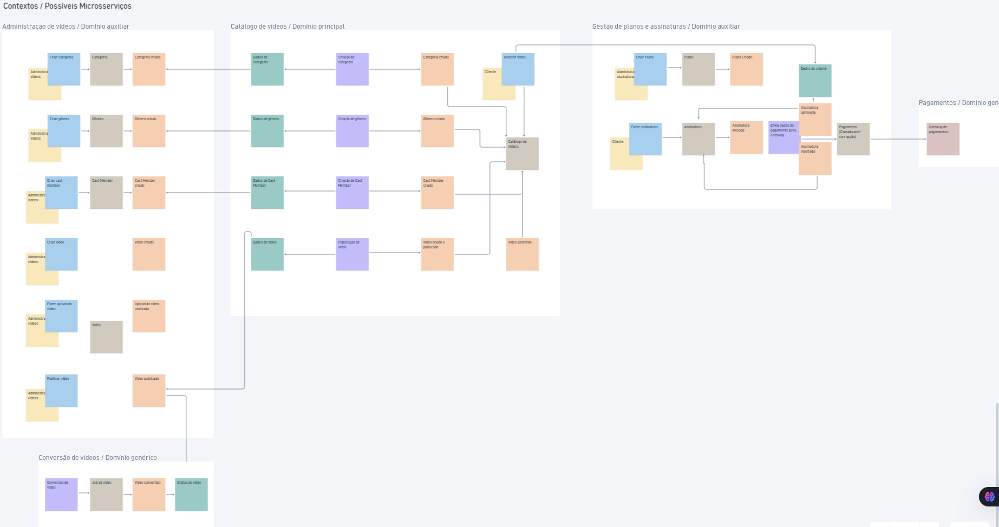
</details>  
<br>

DDD  
DDD é uma abordagem de modelagem/arquitetura 
detalhando como o domínio e as decisões de modelagem foram aplicados no projeto

- utlizando conceitos de uma modelagem mais rica, facilita o entendimento da arquitetura em camadas do software de forma mais madura
- ddd: domain driven design
  - design tatico
    - entidade, objeto de valor, repository

---

### estilos e padroes arquiteturais
- forma de organizar os componentes de um sistema e as relações entre eles, seguindo determinadas características estruturais
  - desacoplar, atualizar componentes, separar complexidades/responsabilidade
  - como o sistema foi organizado e como suas partes se comunicam?
  - microserviços
- arquitetura em camadas
- Arquitetura Hexagonal (Ports and Adapters)
  - 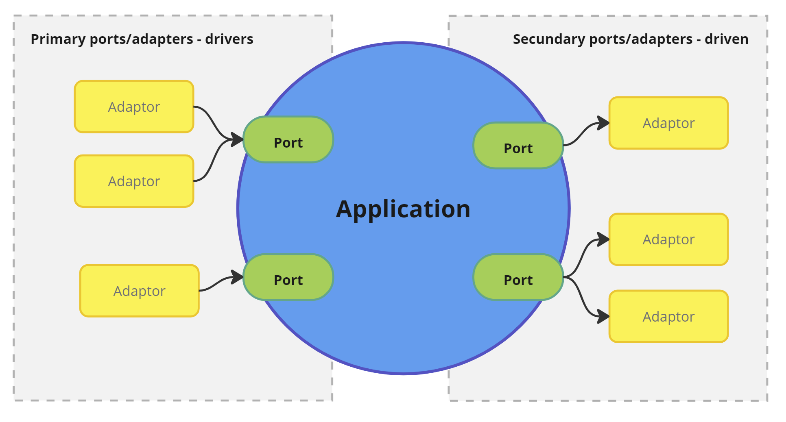
  - organiza o sistema inteiro, isolando o núcleo da aplicação (regras de negócio) de agentes externos como bancos de dados, interfaces gráficas e APIs por meio de portas (ports) e adaptadores (adapters).
  - core
    - src/core
  - Driver (esquerda / quem dispara)
    - controller api rest
      - adapter de entrada (Nest/REST)
      - port é o use case
  - Driven (direita / o core dispara) 
    - repository
      - port: ICategoryRepository, repository-interface.ts
      - adapter: CategorySequelizeRepository, CategoryInMemoryRepository
      - usado no usecase
      - O repositório concreto é um adaptador driven: a aplicação o aciona para persistir ou buscar dados. Ele pode usar o ORM, que usa o driver do PostgreSQL para se comunicar com o banco.
        - Fluxo: aplicação → repositório → ORM → driver PostgreSQL → banco.
    - validação
      - port: validator-fields-interface.ts
      - adapter: 
        - src/core/shared/domain/validators/class-validator-fields.ts
          - src/core/cast-member/domain/cast-member.validator.ts
      - validate domain
    - storage
      - port: src/core/shared/application/storage.interface.ts
      - adapter: src/core/shared/infra/storage/google-cloud.storage.ts
      - usado no usecase
- clean architecture
  - 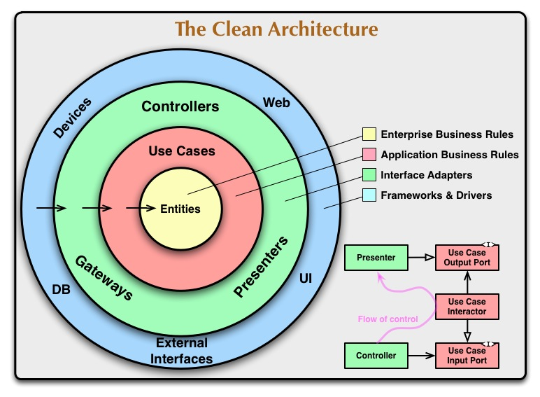
  - organiza o software em camadas, mantendo as regras de negócio independentes de detalhes externos, como bancos de dados, interfaces gráficas e frameworks.
  - construir o nucleo primeiro e deixar o mais puro possivel
    - mantivel ao longo do tempo e independente de tecnologia
    - consigo trocar os frameworks com essa estrategia, ex: nestjs, express, banco
    - uncle bob - framework é detalhe
  - enterprise business rules
    - São regras essenciais para o próprio negócio, que continuariam existindo mesmo que não houvesse um sistema computacional para automatizá-las.
    - entities
      - src/core/cast-member/domain
      - ddd
  - application business rules
    - São regras que definem e restringem como um sistema automatizado deve funcionar
    - usecases
      - conceito 
        - executa uma operação da aplicação, coordenando regras de negócio e dependências para atender a uma intenção, como criar, consultar ou atualizar um vídeo.
        - intenções do usuário
        - orquestração
      - category
        - Create: Criação de uma nova categoria.
        - Update: Atualização de uma categoria existente.
        - Delete: Remoção de uma categoria.
        - Get: Recuperação de uma categoria específica.
        - Search/List: Listagem e busca de categorias.
    - Handler
      - operações em resposta a um evento — por exemplo, publicar um evento no RabbitMQ ou consumir a mensagem e chamar o use case.
    - application service
      - é um auxiliar para consolidação das regras de negocio na camada de aplicação
      - disparar os eventos do dominio e integracao
      - orquestra unit of work e domainEventMediator
  - interface adapters
    - presenters
      - categoryOuput
        - src/nest-modules/categories-module/categories.presenter.ts
        - collection, pagination, data, metadata
        - class-transform
    - controllers
      - api rest
        - category
          - src/nest-modules/categories-module/categories.controller.ts
      - consumer rabbitmq
        - src/nest-modules/videos-module/videos.consumers.ts
    - gateways
      - repository
        - src/core/video/domain/video.repository.ts
        - src/core/video/infra/db/sequelize/video-sequelize.repository.ts
        - src/nest-modules/videos-module/videos.providers.ts
      - storage gcp
        - src/core/shared/application/storage.interface.ts
        - src/core/shared/infra/storage/google-cloud.storage.ts
        - src/nest-modules/shared-module/shared.module.ts
      - message broker
        - src/core/shared/application/message-broker.interface.ts
        - src/core/shared/infra/message-broker/rabbitmq-message-broker.ts
        - src/nest-modules/rabbitmq-module/rabbitmq.module.ts
  - dependencias apontam para o centro
    - camada interna não conhece a camada mais externa
    - a camada interage com a camada diretamente ao lado
  - tipos de duplicação
    - essencial, acidental
      - src/core/video/application/use-cases/upload-audio-video-medias/upload-audio-video-medias.use-case.ts
- cqrs
  - separa totalmente os modelos de leitura e escrita,  handlers/use cases, bancos ou fluxos separados. leva essa separação para arquitetura.
  - src/core/video/application/create-video/create-video.use-case.ts
  - src/core/video/application/get-video/get-video.use-case.ts
  - src/nest-modules/videos-module/videos.controller.ts
- arquitetura orientada a eventos
  - ver secao dela mais abaixo

---

### arquitetura orientada a eventos
- A arquitetura orientada a eventos organiza a comunicação em torno de acontecimentos: um componente publica que algo ocorreu, e outros componentes interessados reagem. Isso desacopla os componentes, pois quem publica o evento não precisa conhecer diretamente quem vai tratá-lo.
  - Desacoplar significa reduzir a dependência entre partes de um sistema, para que uma possa mudar ou funcionar sem exigir mudanças na outra.
- **contextualizando: uma das formas de utilização dos eventos neste projeto é o processamento assíncrono de mídias.**
  - O frontend precisa conseguir iniciar a reprodução antes que o vídeo inteiro seja baixado. Por isso, após receber o MP4 enviado pelo administrador, o encoder o converte em segmentos MPEG-TS e gera uma playlist HLS, que permite transmitir o vídeo em partes.
    - O MP4 costuma ser usado como formato de entrada por ser comum e prático para quem envia vídeos, por exemplo, a partir de ferramentas de gravação e edição.
  - Quando um administrador envia uma mídia MP4, o arquivo é armazenado no GCS. O caso de uso atualiza o agregado Video, que registra um evento de domínio; o repositório adiciona o agregado ao UnitOfWork. O ApplicationService usa o DomainEventMediator para despachar os eventos. Após o commit, o evento de domínio gera um evento de integração, que um handler publica no RabbitMQ. O serviço de encoding consome esse evento, processa a mídia — por exemplo, convertendo MP4 para MPEG — e publica o resultado. O consumidor recebe o resultado e atualiza o vídeo. Quando todas as mídias obrigatórias foram processadas, o agregado pode marcá-lo como publicado.
- **tipos de eventos no DDD**
  - evento de domínio (Domain Event):
    - representa um acontecimento relevante dentro do próprio bounded context (contexto delimitado).
    - comunica mudanças ou acontecimentos relevantes dentro do contexto de negócio.
    - exemplo: `VideoAudioMediaReplaced`.
    - arquivo: `src/core/video/domain/domain-events/video-audio-media-replaced.event.ts`
  - evento de integração (Integration Event):
    - representa um acontecimento que precisa ser comunicado a outros bounded contexts ou sistemas.
    - neste projeto, o evento de domínio `VideoAudioMediaReplaced` gera, por meio de `getIntegrationEvent()`, o evento de integração `VideoAudioMediaUploadedIntegrationEvent`.
    - esse evento é publicado no RabbitMQ para comunicar ao microserviço responsável pelo encoding que uma nova mídia precisa ser processada.
  - diferença:
    - evento de domínio: comunica um acontecimento dentro do contexto de negócio.
    - evento de integração: comunica um acontecimento relevante para outros contextos ou sistemas.
- **propagando eventos de domínio dentro do próprio agregado e disponibilizando-os para a camada superior**
  - exemplo: agregado `Video`
    1. Para tornar o vídeo visível no catálogo (frontend), suas mídias obrigatórias, como vídeo e trailer, precisam estar com o status `completed`.
    2. Os handlers locais são registrados durante a instanciação do agregado `Video`.
    3. A criação do vídeo ou a substituição de uma mídia dispara eventos locais, recebidos pelos handlers dentro do próprio agregado.
       - handlers locais:
         - `onVideoCreated`
         - `onAudioVideoMediaReplaced`
       - eventos:
         - `VideoCreatedEvent`
         - `VideoAudioMediaReplaced`
    4. Quando os eventos são disparados, os handlers tentam executar `.tryPublished()`, que verifica se todas as condições necessárias para publicação foram atendidas.
  - arquivos úteis:
    - `src/core/video/domain/video.aggregate.ts`
    - `src/core/shared/domain/events/domain-event.interface.ts`
    - `src/core/shared/domain/aggregate-root.ts`
- **orquestração dos eventos na camada de aplicação**
  - a camada de aplicação coordena a propagação dos eventos produzidos pelos agregados, tanto dentro do próprio contexto quanto para outros sistemas.
  - exemplo: caso de uso de upload de vídeo
    1. O caso de uso recebe os dados do upload.
    2. O agregado `Video` realiza as operações de domínio e registra os eventos correspondentes.
    3. O repositório adiciona o agregado ao `UnitOfWork`.
    4. O `ApplicationService` coordena o despacho dos eventos dos agregados.
    5. Os handlers registrados recebem os eventos correspondentes.
    6. Os eventos de integração são publicados no RabbitMQ.
  - dois momentos diferentes de despacho:
    - despacho local no agregado:
      - os handlers locais são chamados imediatamente por `applyEvent`, dentro do próprio agregado.
      - exemplo: ao substituir uma mídia, o handler local executa `.tryPublished()`.
    - despacho na camada de aplicação:
      - o `ApplicationService` coordena o despacho dos eventos registrados nos agregados.
      - os eventos de domínio são encaminhados ao `DomainEventMediator`.
      - o `UnitOfWork` realiza o commit da transação.
      - após o commit, os eventos de integração são publicados.
  - observação sobre consistência e entrega:
    - a publicação dos eventos de integração acontece depois do commit do banco de dados.
    - não existe, nesse fluxo, garantia de entrega atômica entre o banco de dados e o RabbitMQ.
      - se a aplicação falhar depois do commit e antes da publicação, a alteração será persistida, mas o evento poderá não ser enviado.
      - o padrão Transactional Outbox é uma alternativa para resolver esse problema: registra o evento na mesma transação da alteração dos dados e realiza sua publicação posteriormente.
      - Consistência é quando as partes de algo combinam entre si e não entram em conflito. Por exemplo, em um sistema, os dados são consistentes quando não se contradizem.
  - arquivos úteis:
    - caso de uso de upload:
      - `src/core/video/application/use-cases/upload-audio-video-medias/upload-audio-video-medias.use-case.ts`
    - `ApplicationService`:
      - `src/core/shared/application/application.service.ts`
    - `DomainEventMediator`:
      - `src/core/shared/domain/events/domain-event-mediator.ts`
    - repositório:
      - `src/core/video/infra/db/sequelize/video-sequelize.repository.ts`
- **integração dos eventos com NestJS**
  - o NestJS é utilizado para registrar eventos, handlers e suas dependências por meio de injeção de dependência.
  - passo a passo:
    1. Registrar o `EventEmitter2` por meio do `EventEmitterModule`, disponibilizando-o globalmente no container de dependências.
    2. Registrar o `DomainEventMediator` com o `EventEmitter2`.
    3. Criar handlers na camada de aplicação e associá-los aos eventos por meio de decorators.
    4. Registrar os handlers no arquivo `videos.providers.ts`.
    5. Registrar o `ApplicationService` com suas dependências, incluindo `UnitOfWork` e `DomainEventMediator`.
    6. Registrar o consumidor responsável pelos eventos externos no módulo de vídeos.
  - acoplamento ao framework:
    - o projeto utiliza mecanismos do NestJS e do `EventEmitter2` na implementação da infraestrutura de eventos.
    - trade-off arquitetural: há acoplamento do mecanismo de eventos ao framework, inclusive no uso de `EventEmitter2` dentro do `AggregateRoot` e de `@OnEvent` nos handlers.
    - benefício: aproveitar os mecanismos de registro, descoberta e injeção de dependências oferecidos pelo NestJS.
    - custo: reduzir a independência do domínio em relação ao framework.
  - arquivos úteis:
    - registro do `EventEmitter2` e `DomainEventMediator`:
      - `src/nest-modules/event-module/event.module.ts`
    - handler da camada de aplicação:
      - `src/core/video/application/handlers/publish-video-media-replaced-in-queue.handler.ts`
    - registro dos handlers:
      - `src/nest-modules/videos-module/videos.providers.ts`
    - registro do `ApplicationService` com `UnitOfWork` e `DomainEventMediator`:
      - `src/nest-modules/use-case-module/use-case.module.ts`
    - consumidor responsável pelos eventos externos:
      - `src/nest-modules/videos-module/videos.consumers.ts`
- **resumo rápido por camada**
  - Domain:
    - `src/core/shared/domain/events/domain-event.interface.ts`
      - define o contrato dos eventos de domínio e de integração.
    - `src/core/video/domain/domain-events/video-created.event.ts`
      - define o evento de criação do vídeo.
    - `src/core/video/domain/video.aggregate.ts`
      - gera eventos de domínio.
      - registra e executa handlers locais.
      - verifica as condições necessárias para publicação do vídeo.
    - `src/core/shared/domain/aggregate-root.ts`
      - gerencia os eventos e handlers associados ao agregado.
  - Application:
    - Domain Event Handler:
      - `src/core/shared/application/domain-event-handler.interface.ts`
      - define o contrato para handlers de eventos de domínio.
      - não há implementação de `DomainEventHandler` nesse bounded context para ações como envio de e-mail, comunicação entre agregados ou atualização de cache.
    - Integration Event Handler:
      - `src/core/video/application/handlers/publish-video-media-replaced-in-queue.handler.ts`
      - implementa o tratamento do evento de integração.
      - publica o evento no RabbitMQ.
    - `DomainEventMediator`:
      - `src/core/shared/domain/events/domain-event-mediator.ts`
      - gerencia a publicação e o despacho dos eventos na camada de aplicação.
      - utiliza o `EventEmitter2` como mecanismo de comunicação.
    - `ApplicationService`:
      - `src/core/shared/application/application.service.ts`
      - auxilia na coordenação das operações da camada de aplicação.
      - coordena o `UnitOfWork` e o `DomainEventMediator`.
      - participa do despacho dos eventos de domínio e de integração.
    - caso de uso:
      - executa o fluxo de upload da mídia.
        - `src/core/video/application/use-cases/upload-audio-video-medias/upload-audio-video-medias.use-case.ts`
      - utiliza o repositório para adicionar o agregado ao `UnitOfWork`.
        - `src/core/video/infra/db/sequelize/video-sequelize.repository.ts`
  - Framework — NestJS:
    - registro do `EventEmitter2` e `DomainEventMediator`:
      - `src/nest-modules/event-module/event.module.ts`
    - handler da camada de aplicação:
      - `src/core/video/application/handlers/publish-video-media-replaced-in-queue.handler.ts`
    - registro dos handlers:
      - `src/nest-modules/videos-module/videos.providers.ts`
    - registro do `ApplicationService`:
      - `src/nest-modules/use-case-module/use-case.module.ts`
    - consumidor responsável pelos eventos externos:
      - `src/nest-modules/videos-module/videos.consumers.ts`
- **observações adicionais**
  - não há implementação de `DomainEventHandler` nesse bounded context para comunicação entre agregados, envio de e-mails ou atualização de cache.
  - o projeto utiliza principalmente `IntegrationEventHandler` para encaminhar eventos ao RabbitMQ.
  - os handlers locais do agregado são diferentes dos handlers registrados na camada de aplicação:
    - os handlers locais reagem imediatamente aos eventos dentro do agregado.
    - os handlers da aplicação participam da propagação dos eventos na aplicação.
---

### mensageria - comunicacao assincrona e processamento assincrono
O fluxo de negócio e a origem dos eventos estão descritos na seção [arquitetura orientada a eventos](#arquitetura-orientada-a-eventos).  

Utilizei RabbitMQ para transportar mensagens e desacoplar o serviço administrativo do microserviço responsável pelo encoding.

Implementei uma abstração chamada IMessageBroker na camada de aplicação e um adaptador RabbitMQMessageBroker na infraestrutura. Dessa maneira, a aplicação depende de um contrato, não diretamente da implementação do RabbitMQ.

A comunicação utiliza exchanges, filas, routing keys, produtores e consumidores.

Também implementei mecanismos de tratamento de falhas, com retry e Dead Letter Queue (DLQ), para permitir o reprocessamento de mensagens quando ocorrem erros recuperáveis e encaminhar mensagens que não podem ser processadas para um fluxo separado.

- Desacoplamento: abstração IMessageBroker e adaptador RabbitMQ.
- Resiliência: retry limitado a três tentativas, atraso de cinco segundos e DLQ.
- Escalabilidade: possibilidade de executar os consumidores em processos separados da API HTTP.

resumo do fluxo:  
gestao de conteudo -> usecase -> agregado -> evento -> dispatcher -> listener -> producer -> mensagem -> rabbitmq -> consumer -> microservico-go -> mp4 -> codificar -> mpeg -> bucket -> producer -> rabbitmq -> consumer -> gestao de conteudo -> encoded_location 

**Modelos de mensageria**
- Message Queue: mensagens vão para uma fila e são distribuídas entre os consumidores dessa fila; cada mensagem é processada por um deles.
- Publish/Subscribe: publicação de mensagens em exchanges, distribuídas para filas conforme bindings e routing keys.
- Event Stream: não implementado neste fluxo. O RabbitMQ é utilizado para entrega de mensagens por filas, sem histórico de eventos consultável e relível pelos consumidores.  

**explicacao da implementacao na aplicacao:**
- port IMessageBroker
  - src/core/shared/application/message-broker.interface.ts
  - contrato, interface, port
  - usado pelo produtor
    - src/core/video/application/handlers/publish-video-media-replaced-in-queue.handler.ts
- adaptador RabbitMQMessageBroker
  - src/core/shared/infra/message-broker/rabbitmq-message-broker.ts
  - adaptador - driven(conduzido) - é acionado pelo sistema, como banco de dados, RabbitMQ ou GCS.
  - tem um catalogo do destino dos eventos
  - usado pelo PublishVideoMediaReplacedInQueueHandler
  - usado pelo RabbitmqConsumeErrorFilter
- produtor do pedido de encoding | handler,listener - PublishVideoMediaReplacedInQueueHandler | event - VideoAudioMediaUploadedIntegrationEvent
  - src/core/video/application/handlers/publish-video-media-replaced-in-queue.handler.ts 
  - escuta o event VideoAudioMediaUploadedIntegrationEvent da aplicacao
  - publica na fila do rabbitmq
  - configuracao - produtor - micro-videos/admin
    - exchange: amq.direct
    - routing-key: nome_do_evento_de_integracao
    - Binding do evento de encoding: o serviço administrativo publica `VideoAudioMediaUploadedIntegrationEvent` no exchange `amq.direct`. O serviço consumidor deve vincular sua fila a esse exchange usando essa mesma routing key.
  - videos-module registra ele
  - event-module registra o eventEmmitter2 e o domainEventMediator com eventEmitter2
  - utilizo o eventEmitter2 dentro do Mediator para disparar os eventos dos agregados
- consumidor do resultado do encoding | event,driver,controller - onProcessVideo | handler,listener,usecase - ProcessAudioVideoMediasUseCase
  - src/nest-modules/videos-module/videos.consumers.ts
  - monitora a fila do rabbitmq
  - configuracao - consumidor - micro-videos/admin
    - onProcessVideo
    - exchange: direct.delayed
      - rabbitmq-module cria a fila
    - routingKey: videos.convert
    - queue: micros-videos/admin
    - dead letter exchange: dlx.exchange
      - routing key dl: videos.convert
      - rabbitmq-module cria a fila e queue dead letter e faz o bind
  - resiliencia - tratamento de falhas
    - dead letter queue
    - retry
      - rabbitmq-module cria a exchange delayed usada pelo consumidor
      - Producer publicá na exchange direct.delayed, com routing key videos.convert.
      - reprocessamento de mensagens
        - src/nest-modules/rabbitmq-module/rabbitmq-consume-error/rabbitmq-consume-error.filter.ts
        - erros não reprocessáveis (`NotFoundError`, `EntityValidationError` e `UnprocessableEntityException`):
          - o filtro rejeita a mensagem sem requeue (`Nack(false)`).
          - a fila `micro-videos/admin` está configurada para encaminhar mensagens rejeitadas ao dead-letter exchange `dlx.exchange`, usando a routing key `videos.convert`.
          - o exchange `dlx.exchange` é do tipo `topic`; a configuração associa a ele a fila `dlx.queue` com a routing key `#`.
        - erros reprocessaveis
          - o filtro republica a mensagem no exchange `direct.delayed`, usando a mesma routing key.
          - adiciona o header `x-retry-count` e define um atraso de 5 segundos (`x-delay`).
          - são feitas até três tentativas de retry. Ao atingir o limite, o filtro rejeita a mensagem sem requeue, encaminhando-a para o fluxo de dead letter.
          - o exchange `direct.delayed` usa o tipo `x-delayed-message`, configurado como `direct`. O atraso depende do plugin `rabbitmq-delayed-message-exchange`, instalado pela imagem Docker do RabbitMQ.
- agregado, evento, usecase
  - Video
    - agregado
    - regra de negocio executa, evento é gerado
  - VideoAudioMediaReplaced
    - evento
  - UploadAudioVideoMediasUseCase
    - upload do video
  - ProcessAudioVideoMediasUseCase
    - atualiza video com o video processado
    - domain event mediator, appservice
- nest config
  - src/nest-modules/rabbitmq-module/rabbitmq.module.ts
    - forRoot
      - global
      - init do rabbitmq e da conexao
        - criar dead letter
        - criar exchange e queue para retry
      - exportar AmqpConnection de um submodulo
        - usado pelo adaptador do messageBroker
        - usado pelo RabbitmqConsumeErrorFilter
    - forFeature
      - registrar adaptador - driven - RabbitMQMessageBroker
        - usado pelo handler
          - src/core/video/application/handlers/publish-video-media-replaced-in-queue.handler.ts
  - src/nest-modules/videos-module
    - registrar o handler
      - src/core/video/application/handlers/publish-video-media-replaced-in-queue.handler.ts
    - registra o consumidor
      - adaptador - driver(condutor) - inicia uma ação no sistema, como uma requisição HTTP.
      - src/nest-modules/videos-module/videos.consumers.ts
  - src/app.module.ts
    - importa rabbitmq-module
    - importa videos-module com handler e consumer        
  - @golevelup/nestjs-rabbitmq
    - lib usada para integrar com rabbitmq
    - mais funcionalidades que a implementacao nativa do nest
- simulacao para teste rapido
  - src/rabbitmq-fake
  - src/rabbitmq-fake.consumer.ts
  - src/app.module.ts


**como executar:**
- orientacoes uteis:
  - env
    - RABBITMQ_REGISTER_HANDLERS
      - se true os consumidores sao registrados na aplicacao
      - config da lib '@golevelup/nestjs-rabbitmq'
  - modo standalone
    - http e consumidor em processos separados
  - docker
    - nao foi colocado como tmps, mas poderia
    - instalacao personalizada com plugin
      - plugin rabbitmq_delayed_message
      - docker/.docker/rabbitmq/Dockerfile
  - Entrypoint dos consumidores: `src/cmd/rabbitmq.ts`
- em desenvolvimento
  - 1. HTTP e consumidores juntos: env `RABBITMQ_REGISTER_HANDLERS=true` e `npm run start:dev`. 
    - Um único processo atende HTTP e consome mensagens.
    - No processo HTTP, o Nest mantém um socket HTTP aberto para receber requisições; o módulo RabbitMQ mantém uma conexão AMQP aberta para consumir mensagens. Os dois sockets podem manter o mesmo processo Node ativo.
  - 2. Só HTTP: `RABBITMQ_REGISTER_HANDLERS=false` e `npm run start:dev`. A API inicia sem consumidores.
  - como acessar em desenvolvimento
    - http://localhost:15672/
      - login: admin
- em producao
  - 1. HTTP e consumidores em processos separados
      - Processo HTTP: `RABBITMQ_REGISTER_HANDLERS=false` \+ `npm run start:prod`
      - Processo consumidor: `RABBITMQ_REGISTER_HANDLERS=true` \+ `npm run rabbitmq:consumers:prod`
      - recomendavel para producao
----

### principios de design
- Orientações para tomar decisões e avaliar se uma solução está bem estruturada.
  - por que você organizou o código dessa maneira?
- princípios específicos  
  - cqs: Command Query Separation
    - métodos ou operações devem ser ou comandos (alteram o estado) ou queries (só consultam dados), nunca ambos.
    - insert, find
      - src/core/video/infra/db/sequelize/video-sequelize.repository.ts
  - ocp: Open Closed Principle (Princípio Aberto-Fechado)
    - componentes devem permitir (extensão) sem alterar seu código original (modificação).
  - solid, poo
    - srp
      - uma classe deve ter apenas um motivo para mudar — ou seja, uma única responsabilidade. 
      - usecase, execute 
        - src/core/cast-member/application/use-cases/create-cast-member/create-cast-member.use-case.ts
      - mapper -> tiro do repository
        - src/core/genre/infra/db/sequelize/genre-model-mapper.ts
      - helper -> tiro do teste
        - src/core/shared/infra/testing/helpers.ts
      - .validate -> tiro de dentro da classe dependente a validacao
        - src/core/cast-member/domain/cast-member.validator.ts
        - src/core/cast-member/application/use-cases/create-cast-member/create-cast-member.input.ts
    - open/closed principle (OCP):
      - componentes devem permitir (extensão) sem alterar seu código original (modificação).
      - Composição
        - injeção no construtor que segue contrato
          - src/core/cast-member/application/use-cases/create-cast-member/create-cast-member.use-case.ts
      - heranca
        - InMemorySearchableRepository
          - personalizar o comportamento do filtro e da ordenacao
          - src/core/shared/infra/db/in-memory/in-memory.repository.ts
          - src/core/genre/infra/db/in-memory/genre-in-memory.repository.ts
        - SearchParams -> entrada repository method search
          - filter -> personalizar sanitizacao do filtro
          - src/core/shared/domain/repository/search-params.ts
          - src/core/category/domain/category.repository.ts
          - src/core/category/infra/db/sequelize/category-sequelize.repository.ts
        - config extende NestConfigModule
          - src/nest-modules/config-module/config.module.ts
        - validacao extende ClassValidatorFields
          - src/core/cast-member/domain/cast-member.validator.ts
        - custom error extende BaseValidationError
          - src/core/shared/domain/validators/validation.error.ts 
        - objeto de valor extende ImageMedia
          - src/core/video/domain/banner.vo.ts 
    - liskov substitution principle (LSP):
      - uma implementação deve respeitar o comportamento que o código espera do tipo que ela substitui.
      - Corretude: Manter o funcionamento esperado do sistema sem introduzir erros ou efeitos colaterais.
    - Interface Segregation Principle, ISP
      - uma interface grande deve ser dividida em interfaces menores e específicas, para que clientes não sejam forçados a depender de métodos que não usam.
      - IRepository e ISearchableRepository separados
    - dip: dependency inversion principle (inversão de dependência)
      - ao invés de módulos de alto nível dependerem diretamente de módulos de baixo nível, ambos passam a depender de abstrações.
      - depender de abstrações e não de implementações concretas
      - exemplo:
        - usecase
          - constructor
            - repository
        - repository
          - constructor
            - sequelize
  - modularizacao
    - organizar o sistema em partes com responsabilidade clara, alta coesão e baixo acoplamento.
    - resultado de outros princípios
    - Separação de concerns (separation of concerns(interesse))
      - core vs nest-modules
    - baixo acoplamento: 
      - ex: use case depende de contrato, não de Sequelize
    - alta coesão: 
      - ex: modulo no core

--- 

### Design Patterns (padrões de projeto)
Neste projeto, podemos identificar vários Design Patterns (padrões de projeto) e padrões arquiteturais consolidados:

   1. Repository Pattern (Padrão Repositório):
      - Abstração da camada de persistência de dados (ex: VideoRepository, CategoryRepository, GenreRepository), desacoplando as regras de negócio do ORM (Sequelize) ou
        armazenamento em memória.

   2. Factory Pattern (Padrão Fábrica):
      - Uso de métodos estáticos de criação (ex: Category.create(...), Video.fake()) e Builders (ex: CategoryFakeBuilder) para instanciar agregados e entidades complexas de
        forma controlada.

   3. Dependency Injection (Injeção de Dependência):
      - Nativo do NestJS, injetando serviços, repositórios e casos de uso via construtores e provedores (providers/useFactory).

   4. Decorator Pattern (Padrão Decorator):
      - Uso extensivo de decorators do NestJS e class-validator (ex: @Controller, @Get, @Post, @UseGuards, @Inject, @Param, @Body, @IsUUID).

   5. Unit of Work (Unidade de Trabalho):
      - Gerenciamento de transações de banco de dados de forma atômica (ex: UnitOfWorkSequelize).

   6. Presenter Pattern (Padrão Apresentador / Serialização):
      - Transformação de objetos de domínio/saída de casos de uso em estruturas serializadas para a API (ex: CategoryPresenter, VideoCollectionPresenter).

   7. Command / Use Case Pattern (Padrão Caso de Uso):
      - Encapsulamento de cada operação de negócio em uma classe dedicada de Caso de Uso que implementa uma interface comum IUseCase (Clean Architecture / DDD).

   8. Observer / Event-Driven Pattern (Eventos de Domínio e Mensageria):
      - Uso de brokers de mensagens (RabbitMQ) e manipuladores de eventos para processamento assíncrono (ex: VideosConsumers, handlers de mídia).
    
- adapter
  - Adaptador: componente que faz a conversão entre interfaces incompatíveis, permitindo que dois componentes se comuniquem. Muitas vezes ligam a aplicação a uma servicos externos, como RabbitMQ ou GCS, mas também podem adaptar componentes internos entre si.
    - Conversão: transformação de algo de uma forma para outra.
  - API - Application Programming Interface  
    - Interface de Programação de Aplicações.
    - API é uma interface específica: define como um programa pode usar outro programa, geralmente por operações, mensagens ou endpoints.
    - Interface: contrato que define como um componente pode ser usado ou acessado.
      - Interface é qualquer ponto de contato ou contrato entre componentes. 

### design patterns
- Design patterns são soluções nomeadas para problemas recorrentes de design.
  - “Mecanismo” pode significar como algo funciona ou as partes que fazem isso funcionar.
  - Mecanismo é a lógica geral de como as partes colaboram. Implementação concreta é o código específico que realiza essa lógica, com uma linguagem ou biblioteca.
- unit of work (design pattern)
  - Unit of Work coordena tudo que precisa acontecer junto para uma operação de domínio ser concluída de forma consistente. 
  - video aggregate
  - trasanction sequelize
  - events 
  - src/core/shared/infra/db/sequelize/unit-of-work-sequelize.ts
- mediator
  - O Mediator serve para reduzir o acoplamento entre objetos: em vez de cada objeto conversar diretamente com vários outros, eles se comunicam por meio de um mediador que coordena as interações.
  - src/core/shared/domain/events/domain-event-mediator.ts
  - Vem do livro Design Patterns: Elements of Reusable Object-Oriented Software (1994), de Gamma, Helm, Johnson e Vlissides — conhecido como o livro da Gang of Four. O Mediator está entre os padrões comportamentais
- adapter
  - Ele serve para integrar interfaces incompatíveis, permitindo que classes com APIs diferentes trabalhem juntas.
  - storage
    - src/core/shared/infra/storage/google-cloud.storage.ts
       - Ele implementa a interface IStorage e adapta o SDK do Google Cloud Storage para o formato esperado pela aplicação.
- Observer
  - O Observer é um padrão comportamental: um objeto se inscreve para receber notificações quando outro objeto publica mudanças ou eventos.
  - EventEmitter2 permite registrar handlers para eventos e chamá-los quando esses eventos são emitidos — um mecanismo semelhante ao padrão Observer.
- Observable
  - No RxJS é um tipo que representa um fluxo de valores ao longo do tempo.

---

### Padrões GoF (Gang of Four) 
Padrões GoF (Gang of Four): Focam em microdecisões de design, resolvendo problemas de colaboração, criação ou estrutura entre classes e objetos individuais (divididos em Criacionais, Estruturais e Comportamentais)
Escopo: O GoF resolve problemas pontuais de código e orientação a objetos; 

---

### generico
- config, variaveis de ambiente
  - local
    - usado pelos testes
    - src/core/shared/infra/config.ts
    - dotenv
      - carregar variveis de ambiente
      - normalmente o dotenv é usado apenas em desenvolvimento para carregar variáveis de ambiente locais, não em produção, onde variáveis já devem estar definidas no ambiente do servidor/container.
  - nest, framework, infraestrutura
    - usado pelas serviços do container de injeção de dependencia e tambem pelos testes e2e
    - src/nest-modules/config-module/config.module.ts
    - criei suportando configurações alem do .env, assim respeitando twelve-factory - chapter 3
    - validação
      - lib typescript joi
- /core: contem as principais operações do dominio, com poucas influencia do nestjs
- /cmd
  - cmd = uma pasta para arquivos que iniciam diferentes partes/modos da aplicação.
  - commands: pontos de entrada da aplicação.
- shared kernel
  - Shared Kernel é um conceito do Domain-Driven Design, descrito por Eric Evans em Domain-Driven Design. É uma parte do modelo e do código compartilhada entre equipes ou contextos, com mudanças coordenadas.
  - src/core/shared

--- 

### upload, storage, gcp
- storage - google cloude storage - assets(imagens, videos)
- como foi usado nesse projeto?
  - upload do video, trailer, imagens
  - Processo de Upload e Publicação de Vídeos
    1. Um funcionário ou administrador faz o upload do arquivo de áudio ou vídeo no microserviço de gestão de conteúdo.
    2. O arquivo é armazenado em um bucket (armazenamento na nuvem).
    3. O sistema dispara um evento indicando que o arquivo de áudio/vídeo foi modificado e publica esse evento no RabbitMQ.
    4. O microserviço em Go responsável pelo encoding consome esse evento, faz o download do arquivo no GCP, realiza o processo de encoding e, ao finalizar, publica um novo evento no RabbitMQ.
    5. O microserviço administrativo possui um consumidor do RabbitMQ que lê esse evento, e então atualiza o vídeo correspondente:
      - Atualiza o status e o caminho do arquivo já encodado no value-object: vídeo ou trailer no agregado vídeo.
    6. Se o vídeo atender a todos os critérios necessários (ex: ter os arquivos de vídeo/trailer processados), ele é atualizado para o status de "published" (publicado).
  - arquivos uteis relacionados
    - src/core/video/application/use-cases/process-audio-video-medias
      - caso de uso usado pelo microserviço de encoded, ele usa para informar o resultado do encoded
    - src/core/video/application/use-cases/upload-image-medias
    - src/core/video/application/use-cases/upload-audio-video-medias
    - src/nest-modules/shared-module/shared.module.ts
      - registra IStorage com o adapter GoogleCloudStorageSdk
- para o sdk do gcs funcionar, precisei atualizar a data do container, alterando o volume no docker compose
- o caso de uso de video cria sem upload  
  - src/core/video/application/use-cases/update-video

---

### autenticacao e autorizacao
- seguranca
- fluxo
  - usuario -> autentica no keycloak -> pega token -> acessa aplicacao backend com token -> aplicacao backend valida o token
- keycloak
  - sistema que gerencia autenticação e autorização.
  - usado para testar o fluxo de autenticacao e autorizacao com a aplicacao backend, quem vai usar ele vai ser o frontend
  - token jwt
  - endpoints
    - olhar api.http
    - xc5
      - chave publica
  - roles
    - admin-catalog
      - gestao de videos no micro-admin-videos
    - assinante
  - config
    - versionei o banco do keycloak, estrutura ja esta montada
    - realm custom, client, user, realm role, role associada ao user
- nest
  - guard
    - src/nest-modules/auth-module/auth.module.ts
    - autenticacao
      - src/nest-modules/auth-module/auth.guard.ts
      - verificar os tokens jwt com a chave publica 
        - import { JwtModule } from '@nestjs/jwt';
      - UnauthorizedException, 401
    - autorizacao
      - src/nest-modules/auth-module/check-is-admin.guard.ts
      - verificar se tem a permissao admin-catalog
      - 401, 403, nestExceptions 
    - testar authGuard 
      - src/nest-modules/categories-module/categories.controller.ts
  - criptografia 
    - assinatura digital
      - algoritmo criptografico 
        - rs256
        - chave publica e privada
    - olhar .env
      - JWT_PUBLIC_KEY
        - vem do keycloak
      - JWT_PRIVATE_KEY
        - esta no keycloak
- scripts
  - usar para 
    - teste e2e
    - gerar chave e token para testar fluxo sem o keycloak
  - script para criar chave publica e privada com rs256
    - lib nativa crypto do node
    - atualizar env
  - script para gerar token jwt assinado com a chave privada
    - lib jsonwebtoken 
  - /crypto
    - pasta com os scripts
    - node crypto/create-rsa.js
      - colar no env
    - node crypto/generate-token.js

----

### persistence layer
- camada de infraestrutura de persistência.
  - É responsável por armazenar, recuperar e gerenciar dados persistentes da aplicação, independentemente do tipo de tecnologia utilizada (bancos, arquivos, filas, caches, buscadores).
  - Database: Armazena dados estruturados ou semi-estruturados para consulta e manipulação (ex: MySQL, PostgreSQL, MongoDB).
  - Storage: Guarda arquivos binários como imagens, vídeos e documentos (ex: Amazon S3, Google Cloud Storage).
  - Cache: Memória temporária para acelerar leituras rápidas (ex: Redis, Memcached).
  - Fila/Mensageria: Gerencia comunicação assíncrona entre sistemas (ex: RabbitMQ, Kafka).
  - Buscador (Search Engine): Permite busca e indexação eficiente de grandes volumes de texto (ex: Elasticsearch).
- repository 
  - search(filter, sort, paginate), crud
  - testes
  - inmemoryRepository
- cardinalidade
  - oneToMany
    - video 
      - video, trailer
      - banner
  - manyToMany
    - genres with categories
    - video
      - castmember
      - genres
      - categories
- orm
  - sequelize: design pattern - active record
    - mysql, sqlite
  - ORM significa Object-Relational Mapping (“Mapeamento Objeto-Relacional”): é uma técnica que permite manipular bancos de dados relacionais usando objetos nas linguagens de programação, facilitando a conversão entre dados do banco e objetos do código.
- mapper
  - toDomain
  - toModel
- unit of work
  - start, rollback, commit
- transaction
  - acid
  - src/nest-modules/videos-module/videos.providers.ts
  - src/nest-modules/genres-module/genres.providers.ts
- migration
  - umzug
    - configuração
      - src/core/shared/infra/db/sequelize/migrator.ts
        - cli no core
      - src/migrate.ts
        - no nestjs usando a cli
    - migrations
      - src/core/*/infra/db/sequelize/migrations
    - model vs migration
      - model:  o ORM cria/altera o banco com base nos Models.
        - usado pelos testes
      - migration: você cria arquivos que descrevem cada alteração no 
      banco.
        - usadas em produção e desenvolvimento
    - comando
      - mostra as funcionalidades disponiveis do umzug
        - dev
          - npm run migrate:ts:with-paths
        - produção
          - npm run migrate:js
      - comandos de exemplo na seção mais abaixo

----

### validações, tratamento de erros
  - validações
    - separação das validações de dominio(regras de dominio) vs validações de sintaxe
    - class-validator
      - categoryRules
      - CastMemberRules
    - joy validator
      - configModule - variaveis de ambiente
    - nest - pipe
  - tratamento de erros, lançamento de exceções
    - either - tratar de forma explicita, alternativa ao throw
    - erros na entidade com notification pattern(acumular erros e no final fazer algo no usecase)
    - nest - filters
    - exceptions especificas inves de new Error generic
  
---

### configurações de qualidade
- Configuração de Qualidade (QA)
  - ferramentas de qualidade para garantir a integridade do código, assegurando cobertura de testes e tipagem correta.
- typescript (tipagem)
  - Criado um script NPM chamado tsc:check que execute o compilador do TypeScript apenas para verificação (sem gerar build), garantindo que não existam erros de tipagem no projeto.
- jest (teste)
  - cobertura de testes
    - Configurado o Jest para que a execução falhe caso a cobertura de código (code coverage) seja inferior a 80%.
    - foi usado apenas para o teste de integração e unidade
    - npm run test:cov
- eslint (regras de código)
- prettier (formatação automatica baseada nas regras)


---

### The Twelve-Factor App
Este projeto aplica várias metodologias do The Twelve-Factor App:

   1. III. Config (Configurações no ambiente): Uso do ConfigModule do NestJS e variáveis de ambiente (.env) para gerenciar parâmetros de configuração sem hardcoding.
   2. II. Dependencies (Dependências explícitas): Gerenciamento de dependências isoladas e declaradas no package.json e package-lock.json.
   3. IV. Backing services (Serviços de suporte): Tratamento de bancos de dados (MySQL/SQLite via Sequelize) e mensageria (RabbitMQ) como recursos acoplados/externos
      configuráveis.
   4. V. Build, release, run (Estágios separados): Separação estrita entre build (npm run build, gerando a pasta dist) e execução (node dist/main).
   5. VII. Port binding (Exportação de serviços): A aplicação expõe sua API REST via ligação de porta HTTP gerenciada pelo NestJS.
   6. X. Dev/prod parity (Paridade entre ambientes): Uso de Docker / Docker Compose e containerização para manter consistência entre desenvolvimento, testes e produção.
   7. XII. Admin processes (Processos administrativos): Scripts dedicados para tarefas de migração de banco de dados (migrate.ts, npm run migration:run).


---

### observabilidade
- Observabilidade → capacidade de entender o estado interno de um sistema a partir dos dados que ele produz.
  - Logs → registros de acontecimentos.
  - Métricas → valores medidos ao longo do tempo.
  - Traces → percurso de uma requisição entre componentes.
- Elastic stack
  - 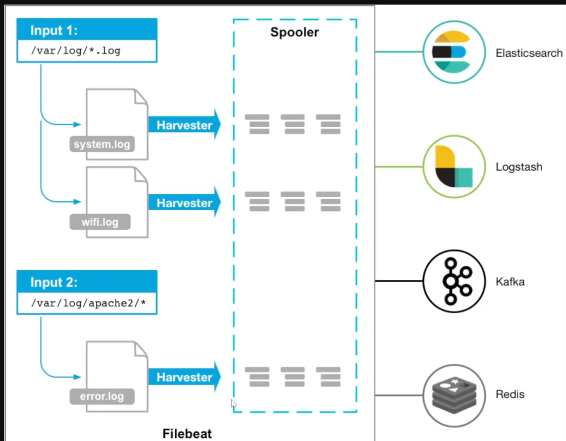
  - elastic Stack → conjunto de componentes para coletar, processar, armazenar e analisar dados.
    - Elasticsearch → armazena e pesquisa dados.
      - banco de dados nosql que guarda as informacoes
    - Logstash → coleta, transforma e encaminha dados.
      - usa a elasticsearch para recuperar as informacoes
    - Kibana → visualiza e analisa dados.
    - Elastic Agent → agente instalado na máquina para coletar dados e enviá-los para a infraestrutura Elastic.
      - Filebeat → é um agente que lê dados de fontes e os envia para um destino. É uma tecnologia anterior ao uso mais amplo do Elastic Agent.
- config no projeto
  - integrar nest com elastic stack
  - fluxo
    - stdout processo -> arquivo log → Filebeat → Logstash → Elasticsearch → Kibana
  - docker
    - config da elasticstack no /docker + ./docker, .gitignore
      - docker/docker-compose.elk.yaml
    - filebeat
      - container independente
      - le o arquivo de log dos outros containers que tem a label
  - executando
    - em desenvolvimento
      - iniciar aplicacao
        - fazer o stdout do start:dev sair no processo principal, para filebeat conseguir ler, pois o start.sh levanta outro processo no pid 1 que não é a aplicação nest. 
        - npm run start:dev &> /proc/1/fd/1
          - log vem com muita formatacao
        - NODE_ENV=production npm run start:dev &> /proc/1/fd/1
          - log simplificado
            - olhar main.ts
      - iniciar o elastic stack
        - docker compose -f ./docker/docker-compose.elk.yaml up --build
      - produzir dados
        - chamar get categories no api.http
        - chave no .env precisa ter assinado o jwtToken do api.http
      - kibana
        - criar index-pattern/data-view
          - menu -> analytics -> discovery
            - logstash-*
            - selecionar @timestamp
        - visualizar dataview
          - menu -> analytics -> discovery
            - filtrar por message
            - exemplo
            - 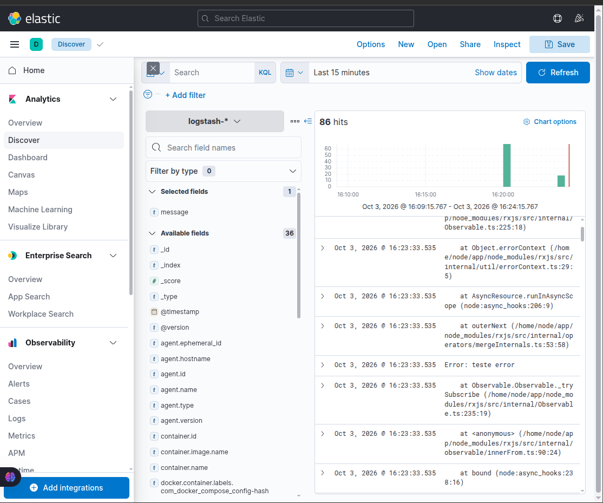 
        - criar relatorio com metrica
          - menu -> dashboard 
            - na secao filter, adicionar campos ao workspace
            - fullcycle.keyword, test.keyword
            - 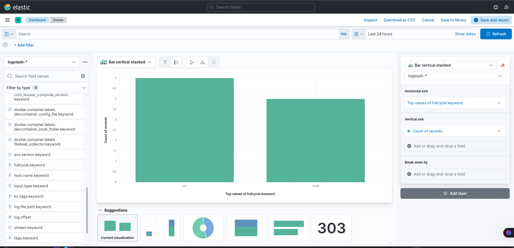
    - outros
      - log dos containers no so
        - /var/lib/docker/containers
      - ver logs do kibana
        - docker compose -f docker/docker-compose.elk.yaml logs -f codeflix-kibana
      - testar curl
        - docker compose -f docker/docker-compose.elk.yaml exec codeflix-kibana curl http://codeflix-elasticsearch:9200

---

### ci, cdel, cdep
- devops
- Integração contínua — Continuous Integration (CI)
  - Prática de juntar frequentemente alterações de código em um mesmo projeto e verificar automaticamente se essas alterações funcionam corretamente.
- Entrega contínua — Continuous Delivery (CD)
  - Prática de manter o software sempre preparado para ser disponibilizado aos usuários.
- Implantação contínua — Continuous Deployment (CD)
  - Prática de colocar automaticamente em produção cada nova versão que passa pelas verificações necessárias.
- config no projeto
  - dockerfile de producao que vai servir para o deployment
    - docker/Dockerfile.prod
      - imagem pequena e otimizada
        - menos disco, dados transferidos na rede
        - download rapido no servidor/kubernetes
        - .dockerignore
      - seguranca
        - principio do menor privilegio
          - non-root user
            - apenas as permissões estritamente necessárias para realizar suas funções
      - artefato
  - docker compose para o CI
    - docker/docker-compose.ci.yaml
    - tmpfs 
    - docker compose -f docker/docker-compose.ci.yaml up --build
    - docker compose exec fc3-codeflix-backend-admin-catalogo-de-videos bash
      - rodar migrations
      - gerar token se precisar
      - printenv | grep NODE_ENV
    - github
      - precisa dos secrets do google storage
      - docker-compose.ci mapeia
  - CI/CD (Integração e Entrega Contínuas): Configurar um pipeline no GitHub Actions
    - ci
      - pipeline (fluxo automatizado)
        - montagem da imagem docker
        - todo: analise estatica
        - rodar os testes
      - github actions
        - automatizar processos
      - docker no ci
        - multi-stage build
          - target: development
            - teste de unidade, integracao, e2e
          - 3 camadas
            - development, builder, production
          - usar o multistage build para otimizar a producao da imagem
        - cache dos layers da imagem
          - github cache
          - acelerar a construção da imagem 
          - Cache → armazenamento temporário de dados que podem ser usados novamente, mantido para evitar buscá-los ou produzi-los novamente.
      - artefatos
        - .github/workflows/ci-cd.yaml
      - 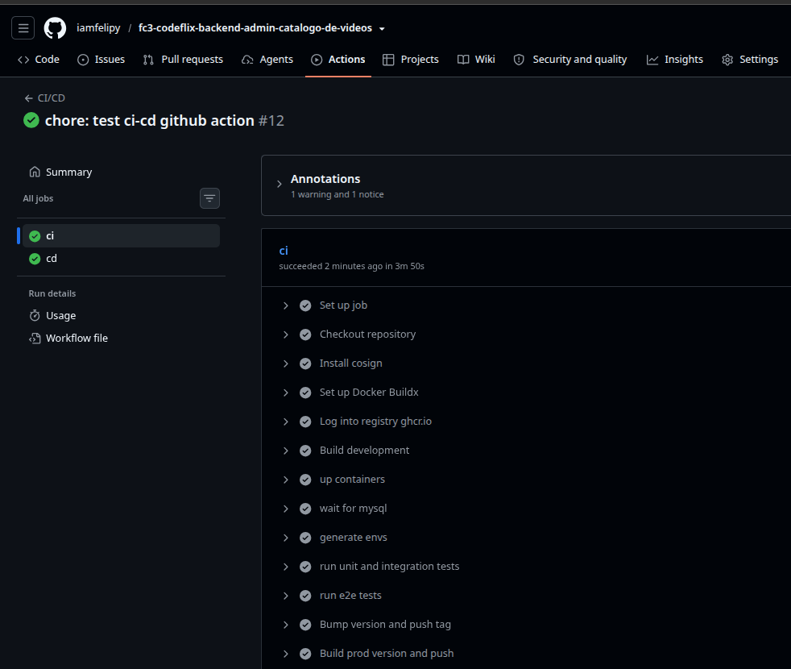
    - cdel
      - pipeline
        - build imagem de producao
        - criar tag github
          - semver
        - gerar pacote no github package
        - publicar imagem no github container registry
      - github packages
        - artefatos empacotados
      - github container registry
        - armazenar imagens
      - 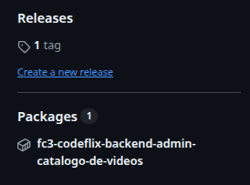
    - cdep

---

### testes
- tdd(test driven development), triple aaa(arrange, act, assert), piramidade de testes
- Test Data Builder(Gof - criacional)
  - CategoryFakeBuilder
- fluent pattern
  - ValidatorRules
- helpers
  - src/core/shared/infra/testing/helpers.ts
    - teste de unidade e integração
  - src/nest-modules/shared-module/testing/helpers.ts
   - teste de integração e e2e
  - src/nest-modules/shared-module/testing/supertest-extend.ts
   - teste e2e
   - atalho para autenticar rotas protegidas
- fixtures (configuração para teste, arranges)
  - teste de integração, e2e
- inmemory
- tecnologia
  - jest
    - arquivo de configuracao diferente para unit, integration e e2e
    - jest-setup.ts -> arquivo codigo na inicializacao
- teste de unidade e integracao
  - npm run test
  - 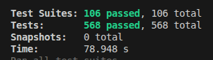
- teste e2e
  - npm run test:e2e:runInBand
  - 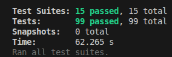
----

### paradigmas de programacao
- estilos ou modelos de pensamento usados para estruturar e organizar programas
- poo
  - encapsulamento, herança, composição, interfaces e imutabilidade.
- funcional
  - src/core/cast-member/domain/cast-member-fake.builder.ts

----

### typescript
- @types
  - extender interface
----

### nestjs

- versão da cli: @nestjs/cli@10.1.17

- inicializa um novo projeto
  - nest new nest
    - select: npm
- novo modulo
  - npx nest g module shared
- controllers
  - api rest
    - recursos
      - categories
      - genres
      - cast members
      - videos
      - src/nest-modules
    - teste manual com client rest
      - api.http
  - class-transformer
    - usado na serialização do output do controller
  - class-validator
    - usado no core e no controller para validar entradas
- pipe
  - validação com class-validator
- interceptor
  - class-transform para transformar a data para toIsoString
  - envolver saida do category get com a propriedade data
- filter
  - tratar execeções do dominio
    - o campo name não pode ter mais de 255 caracters, criar entidade e notification
    - not found id no usecase, repository update
- helper
  - test
    - startApp - inicia modulo, banco para o teste e2e
- variaveis de ambiente
  - src/nest-modules/config-module/config.module.ts
- nest-modules/shared-module
  - agrupar logica e serviços reutilizaveis
  - global
  - serviços
    - storage
    - domainEventMediator
    - appService
  - presenter
    - paginacao
    - collection
  - filters, interceptors, testing
- injeção de dependencia
  - scope.request
    - appService
    - unit of work
    - src/nest-modules/shared-module/shared.module.ts
- upload de arquivos com multer, express, interceptor, multipart/data-form
  - src/nest-modules/videos-module/videos.controller.ts
- eventos
  - integrar os eventos do dominio com nest
  - nest tem decorator pra registrar evento e handler
  - nest implementa o pattern observer com eventEmitter2
  - ao carregar o eventEmitter2 do pacote nest, ele registra o servico de forma global no container de servicos
- guard
  - proteger requisicao

----

### docker
- como está organizado a config do docker?
- docker-compose.yml
  - usa tmpfs
  - tmpfs
    - util para teste
    - carrega pasta do mysql na memoria ram
- docker-compose.dev.yml
  - util para desenvolvimento
  - usa volumes inves de tmpfs, quando reiniciar o container não perde a pasta
  - foi usado pq devcontainer não esta reconhecendo !reset do tmpfs do docker-compose.override.yaml, se reconhece-se era só descomentar .example do override para poder mudar de ambiente.
  - O padrão é usar o docker-compose.yml. O docker-compose.dev.yml só é usado se você especificar explicitamente com a flag -f ou configurar no devcontainer.json.
- docker-compose.overvire.yaml
  - usaria isso com docker-compose.yml se o devcontainer reconhece-se !reset
- devcontainer
  - devcontainer.json.example
    - por padrão está configurando para usar docker-compose.yml
- rabbitmq
  - instalacao personalizada com plugin
    - plugin rabbitmq_delayed_message
    - docker/.docker/rabbitmq/Dockerfile
- keycloak
  - docker compose -f ./docker/docker-compose.keycloak.yaml up
    - sudo chmod -R 777 docker/.docker/keycloak_data
  - extra_hosts
    - mapeamentos de nomes de host para endereços IP
  - localhost:8080
    - admin
    - admin
  - mapeia o volume keycloak, talvez quando iniciar nao precisar criar o realm, client, user
----

### como rodar o projeto

- como executar o projeto localmente
  - etapa 1: instalar o docker
  - etapa 2: com ou sem devcontainer
    - como executar com dev container
      - criar devcontainer.json baseado no ./devcontainer/devcontainer.json.example
        - posso escolher a opção dockercomposefile dentro do arquivo devcontainer.json para apontar para:
          - docker-compose.yaml:
            - volume do mysql em tmpfs
              - util para teste ou usar em memoria
          - docker-compose.dev.yaml: 
            - volume mysql persistente
            - modo dev
      - instalar extensão dev container
        - abrir command pallete: ctrl + shift + p 
        - digitar > dev container
        - escolher: reopen in container
    - como executar sem dev container
      - instalar extensoes vscode
        - devcontainer
        - eslint
          - regra de codigo
          - dbaeumer.vscode-eslint
        - pretty
          - yoavbls.pretty-ts-errors
          - formatar
        - rest client
          - testar api com o arquivo api.http e com npm run start:dev
      - comandos
        - iniciar ambiente
          - docker compose -f docker/docker-compose.yml up --build
        - acessar container
          - docker exec -it fc3-codeflix-backend-admin-catalogo bash
  - etapa 3: dentro do container
    - como executar os testes
      - tecnologia: jest
      - teste de unidade, integração
        - jest, arquivo de configuracao
          - jest.config.ts
        - criar /envs/.env.test com base no .env.test.example
          - sqlite inmemory
        - npm run test
          - se NODE_ENV estiver undefined ou null, o Jest define como 'test'.
      - teste end-to-end(e2e)
        - jest, arquivo de configuracao
          - test/jest-e2e.config.ts
        - criar /envs/.env.e2e com base no .env.e2e.example
        - usar docker-compose.yaml
          - mysql em memoria
        - npm run test:e2e:runInBand
          - os testes foram projetos para funcionar só de forma sequencial para não dar conflito ao mudar o mesmo schema
          - Para npm run test:e2e:runInBand, o test/jest-setup.ts sobrescreve o valor de NODE_ENV para e2e
    - executar em modo dev
      - criar /envs/.env com base no .env.example
        - sqlite inmemory
      - executar em modo dev
        - npm run start:dev
        - se precisar de observabilidade, ler a secao dela e complementar com essa
      - banco de dados
        - migrations
          - para mysql persistente usar o docker-compose.dev.yaml
          - executar as migrations 
            - migrate:ts:with-paths up
          - comandos de exemplo na seção mais abaixo
      - rabbitmq
        - ler a abaixo
        - usar o 1
      - autenticacao 
        - ler a secao dela
        - relacionada com keycloak
      - observabilidade
        - ler a secao de dela
- rabbitmq
  - olhar a secao ¨mensageria - comunicacao assincrona e processamento assincrono¨
- keycloak
  - docker compose -f ./docker/docker-compose.keycloak.yaml up
    - sudo chmod -R 777 docker/.docker/keycloak_data
- extra
  - env
    - usou .env com mysql e DB_AUTO_LOAD_MODELS=false e sem sequelize.sync, evita conflito entre migrations e com o array de models carregados na inicialização nest
  - eu posso mudar o banco via .env* ou nos tests via config-module
    - alguns testes usam a configuração do banco direto, sem env
  - testando a api com rest client extension + ./api.http
    - npm run start:dev
    - executar chamadas do ./api.http
  - exemplo de credenciais estão no githubgist

### comandos
```bash
#docker
  # rebuild e subir se alterar manifesto/dockerfile/docker-compose
  docker compose -f docker/docker-compose.yaml up --build

# tests
npm run test
npm run test — — watch

# coverage html - resultado do teste de unitade e integração
npm run test:cov

# analise estatica do typescript sem gerar build
 npm run tsc:check

# migration umzug
- mostra as funcionalidades disponiveis do umzug
  - dev
    - npm run migrate:ts:with-paths
  - produção
    - npm run migrate:js
- ver funcionalidades disponiveis do create
  npm run migrate:ts:with-paths create -- --help

- cria migration
  - dar um nome sugestivo, do que está sendo feito
  - mover para a pasta do modulo correspondente
  npm run migrate:ts:with-paths create -- --name create-categories-table.ts --folder ./src

- mostra migrations pendentes
  - npm run migrate:ts:with-paths pending
- aplica migrations pendentes
  - npm run migrate:ts:with-paths up
- desfaz migrations
  - npm run migrate:ts:with-paths down               # desfaz apenas a última migration
  - npm run migrate:ts:with-paths down -- --step 2   # desfaz as 2 últimas migrations
  - npm run migrate:ts:with-paths down -- --to 0   # desfaz todas as migrations, volta ao estado inicial

# container mysql, comandos uteis
mysql -uroot -proot
show databases;
drop database micro_videos;
create database micro_videos;
use micro_videos;
show tables;
drop table categories;
describe categories;
select * from SequelizeMeta;

```

----

### como rodar o projeto em producao
- todo -> deploy
  - github action so faz ci, cdel
  - a imagem de producao nao precisa redirecionar o stdout, pois o processo principal eh o nest
---

projeto pai:
[Link para o projeto pai](https://github.com/iamfelipy/fc3-codeflix-netflix)
---
[Resumo de aprendizados do Full Cycle 3.0](./fc3-aprendizado.md)